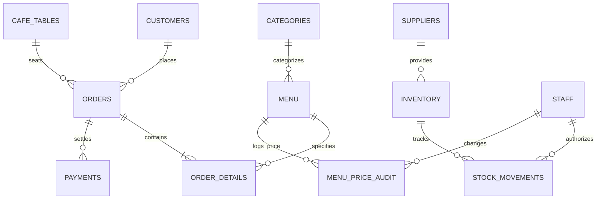

# CaféNest — Database Design Document

## 1. Overview
The **CaféNest** database is implemented in **MySQL (InnoDB Engine)** with character set `utf8mb4`. It encapsulates 12 core normalized relational tables enforcing referential integrity, unique constraints, and transaction safety.

---

## 2. Entity Relationship (ER) Diagram

---

## 3. Core Relational Tables Specification

### 1. `customers`
Stores registered customer accounts, loyalty balance, and contact credentials.
- `customer_id` INT AUTO_INCREMENT PRIMARY KEY
- `name` VARCHAR(100) NOT NULL
- `email` VARCHAR(150) NOT NULL UNIQUE
- `password_hash` VARCHAR(255) NOT NULL (SHA-256)
- `phone` VARCHAR(20)
- `address` TEXT
- `loyalty_points` INT NOT NULL DEFAULT 50
- `created_at` TIMESTAMP DEFAULT CURRENT_TIMESTAMP

### 2. `categories`
Groups food and beverage offerings.
- `category_id` INT AUTO_INCREMENT PRIMARY KEY
- `category_name` VARCHAR(50) NOT NULL UNIQUE
- `description` VARCHAR(255)
- `display_order` INT DEFAULT 0
- `is_active` BOOLEAN DEFAULT TRUE
- `created_at` TIMESTAMP DEFAULT CURRENT_TIMESTAMP

### 3. `menu`
Food & beverage catalog with pricing, diet flags, and availability.
- `menu_id` INT AUTO_INCREMENT PRIMARY KEY
- `category_id` INT NOT NULL (FK -> `categories.category_id`)
- `name` VARCHAR(100) NOT NULL
- `description` TEXT
- `price` DECIMAL(10,2) NOT NULL
- `image_url` VARCHAR(500)
- `is_veg` BOOLEAN DEFAULT TRUE
- `is_available` BOOLEAN DEFAULT TRUE
- `created_at` TIMESTAMP DEFAULT CURRENT_TIMESTAMP
- `updated_at` TIMESTAMP DEFAULT CURRENT_TIMESTAMP ON UPDATE CURRENT_TIMESTAMP

### 4. `cafe_tables`
Dine-in tables, seating capacities, and live occupancy status.
- `table_id` INT AUTO_INCREMENT PRIMARY KEY
- `table_number` VARCHAR(20) NOT NULL UNIQUE
- `seating_capacity` INT DEFAULT 2
- `location_area` VARCHAR(50) DEFAULT 'Main Dining Hall'
- `status` ENUM('Available', 'Occupied', 'Reserved') DEFAULT 'Available'
- `updated_at` TIMESTAMP DEFAULT CURRENT_TIMESTAMP ON UPDATE CURRENT_TIMESTAMP

### 5. `orders`
Header record for customer purchases with server-validated totals.
- `order_id` INT AUTO_INCREMENT PRIMARY KEY
- `order_reference` VARCHAR(50) NOT NULL UNIQUE (e.g. `NEST-XXXXX`)
- `customer_id` INT NULL (FK -> `customers.customer_id`)
- `table_id` INT NULL (FK -> `cafe_tables.table_id`)
- `order_type` ENUM('Dine-In', 'Takeaway') DEFAULT 'Dine-In'
- `status` ENUM('Pending', 'Confirmed', 'Preparing', 'Ready', 'Completed', 'Cancelled') DEFAULT 'Pending'
- `subtotal` DECIMAL(10,2) NOT NULL
- `tax_amount` DECIMAL(10,2) NOT NULL (5% GST)
- `total_amount` DECIMAL(10,2) NOT NULL
- `special_instructions` TEXT
- `created_at` TIMESTAMP DEFAULT CURRENT_TIMESTAMP
- `updated_at` TIMESTAMP DEFAULT CURRENT_TIMESTAMP ON UPDATE CURRENT_TIMESTAMP

### 6. `order_details`
Line items belonging to an order.
- `order_detail_id` INT AUTO_INCREMENT PRIMARY KEY
- `order_id` INT NOT NULL (FK -> `orders.order_id` ON DELETE CASCADE)
- `menu_id` INT NOT NULL (FK -> `menu.menu_id`)
- `quantity` INT NOT NULL
- `unit_price` DECIMAL(10,2) NOT NULL
- `subtotal` DECIMAL(10,2) NOT NULL

### 7. `payments`
Simulated and demonstration transaction records.
- `payment_id` INT AUTO_INCREMENT PRIMARY KEY
- `order_id` INT NOT NULL (FK -> `orders.order_id` ON DELETE CASCADE)
- `amount` DECIMAL(10,2) NOT NULL
- `method` ENUM('Cash', 'Simulated_UPI') NOT NULL
- `status` ENUM('Completed', 'Pending', 'Failed') DEFAULT 'Completed'
- `transaction_ref` VARCHAR(100) NOT NULL
- `is_simulated` BOOLEAN DEFAULT TRUE
- `paid_at` TIMESTAMP DEFAULT CURRENT_TIMESTAMP

### 8. `staff`
Internal team credentials and role permissions.
- `staff_id` INT AUTO_INCREMENT PRIMARY KEY
- `name` VARCHAR(100) NOT NULL
- `email` VARCHAR(150) NOT NULL UNIQUE
- `password_hash` VARCHAR(255) NOT NULL (SHA-256)
- `phone` VARCHAR(20)
- `role` ENUM('Admin', 'Cashier', 'Barista', 'Waitstaff') DEFAULT 'Admin'
- `is_active` BOOLEAN DEFAULT TRUE
- `created_at` TIMESTAMP DEFAULT CURRENT_TIMESTAMP

### 9. `suppliers`
Vendor contact records for beans, dairy, flour, and botanicals.
- `supplier_id` INT AUTO_INCREMENT PRIMARY KEY
- `supplier_name` VARCHAR(100) NOT NULL
- `contact_name` VARCHAR(100)
- `phone` VARCHAR(20)
- `email` VARCHAR(150)
- `address` TEXT
- `supplied_items` VARCHAR(255)
- `is_active` BOOLEAN DEFAULT TRUE
- `created_at` TIMESTAMP DEFAULT CURRENT_TIMESTAMP

### 10. `inventory`
Stock ingredient levels with automated low-stock warnings.
- `inventory_id` INT AUTO_INCREMENT PRIMARY KEY
- `supplier_id` INT NULL (FK -> `suppliers.supplier_id`)
- `item_name` VARCHAR(100) NOT NULL
- `quantity` DECIMAL(10,2) DEFAULT 0.00
- `unit` VARCHAR(20) NOT NULL
- `reorder_level` DECIMAL(10,2) DEFAULT 10.00
- `cost_per_unit` DECIMAL(10,2) DEFAULT 0.00
- `updated_at` TIMESTAMP DEFAULT CURRENT_TIMESTAMP ON UPDATE CURRENT_TIMESTAMP

### 11. `stock_movements`
Audit log of stock intake, daily prep usage, and spoilage.
- `movement_id` INT AUTO_INCREMENT PRIMARY KEY
- `inventory_id` INT NOT NULL (FK -> `inventory.inventory_id` ON DELETE CASCADE)
- `quantity_change` DECIMAL(10,2) NOT NULL
- `reason` ENUM('Restock', 'Waste / Spoilage', 'Daily Prep Usage', 'Inventory Audit Adjustment', 'Returned') NOT NULL
- `notes` VARCHAR(255)
- `staff_id` INT NULL (FK -> `staff.staff_id`)
- `created_at` TIMESTAMP DEFAULT CURRENT_TIMESTAMP

### 12. `menu_price_audit`
Complete historical audit log of menu price revisions.
- `audit_id` INT AUTO_INCREMENT PRIMARY KEY
- `menu_id` INT NOT NULL (FK -> `menu.menu_id` ON DELETE CASCADE)
- `old_price` DECIMAL(10,2) NOT NULL
- `new_price` DECIMAL(10,2) NOT NULL
- `changed_by_staff_id` INT NULL (FK -> `staff.staff_id`)
- `changed_at` TIMESTAMP DEFAULT CURRENT_TIMESTAMP
